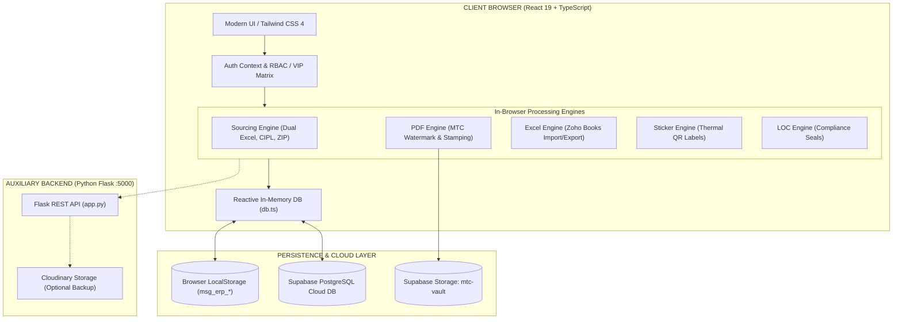
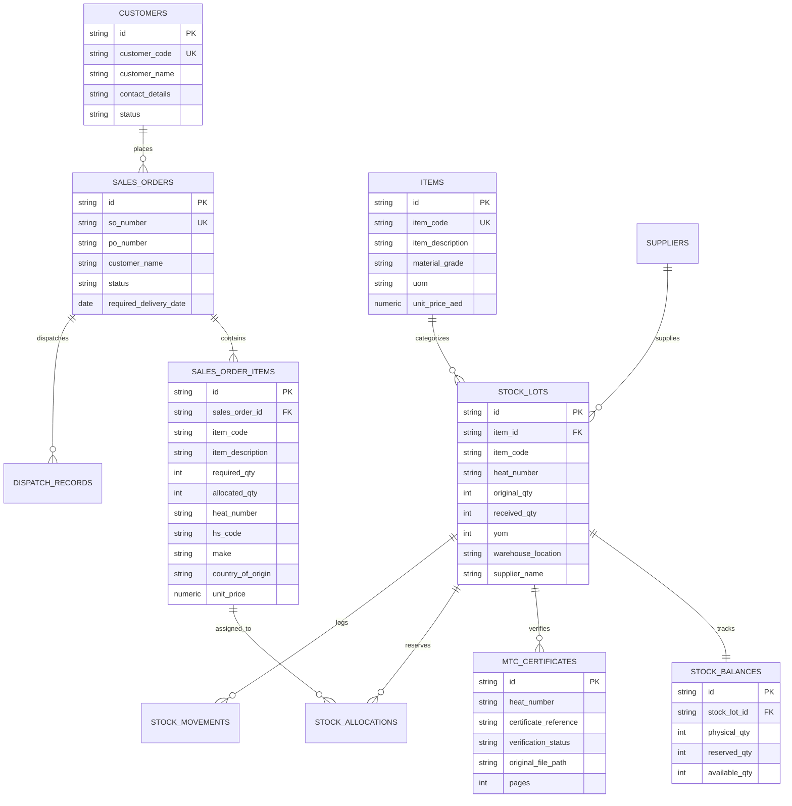
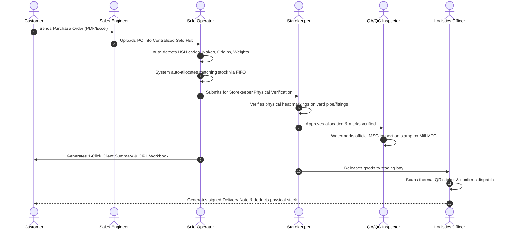

# MSG Oilfield Equipment Trading LLC
# Application Architecture & System Engineering Overview
**Document Reference**: QA-ARCH-2026-V1.0  
**Project**: MSG Oilfield ERP & MTC Vault System  
**Lead Auditor**: Senior QA Architect & Principal Systems Auditor  
**Execution Date**: November 19, 2026  

---

## 1. System Architecture Overview

The **MSG Oilfield ERP & MTC Vault** is designed as a high-reliability, dual-engine enterprise application combining:
1. A **High-Performance Client-Side React SPA** that executes heavy document generation (ExcelJS, XLSX, PDF-Lib, QR rendering) directly inside the client browser, ensuring zero operational downtime even during complete internet/server disconnections.
2. A **Reactive Data Engine (`db.ts`)** with dual persistence: In-Browser Local Storage with live pub-sub listeners + Cloud Supabase PostgreSQL with S3-compatible MTC document storage.
3. An **Auxiliary Microservices Backend (Python Flask)** used for cloud document backups, Cloudinary media storage, and serverless document transformations.

---

## 2. Technology Stack & Dependency Inventory

### 2.1 Frontend Framework & Core Libraries
| Component | Package / Technology | Version | Purpose |
|:---|:---|:---|:---|
| **Core Framework** | `react` | `^19.3.1` | Core declarative UI component framework. |
| **DOM Renderer** | `react-dom` | `^19.3.1` | Virtual DOM rendering and event hydration. |
| **Language & Compiler** | `typescript` | `~7.0.2` | Static typing, interface contracts, and compilation. |
| **Build Engine** | `vite` | `^8.3.5` | Next-generation bundler with native ESM and HMR. |
| **Styling Framework** | `tailwindcss` | `^4.3.3` | Utility-first styling with `@tailwindcss/vite` plugin. |
| **Iconography** | `lucide-react` | `^1.63.0` | Comprehensive enterprise SVG icon set. |
| **Spreadsheet Engine** | `exceljs` | `^4.4.0` | Formatted multi-tab XLSX generation with styles. |
| **Spreadsheet Ingestion** | `xlsx` (SheetJS) | `^0.18.5` | High-speed tabular parsing for large order files. |
| **PDF Manipulation** | `pdf-lib` | `^1.17.1` | Client-side PDF stamping, merging, and signing. |
| **Archive Bundler** | `jszip` | `^3.10.2` | In-memory ZIP packaging for supplier POs. |
| **QR Code Engine** | `qrcode` | `^1.5.4` | Vector & PNG QR generation for warehouse scanning. |
| **Cloud Client** | `@supabase/supabase-js` | `^2.118.0` | PostgreSQL REST client and storage bucket driver. |
| **Linter / Static QA** | `oxlint` | `^1.89.0` | High-performance Rust-based JavaScript/TypeScript linter. |

### 2.2 Backend & Auxiliary Microservice Stack
| Component | Technology | Version | Purpose |
|:---|:---|:---|:---|
| **Web Server** | Python Flask | `3.0+` | Microservice for document conversion and history. |
| **PDF Generation** | `reportlab` | `3.6+` | Server-side thermal label & compliance PDF rendering. |
| **Media Cloud Storage** | `cloudinary` | `1.36+` | Redundant cloud backup for client & stores sheets. |
| **Cloud Database** | PostgreSQL (Supabase) | `15.x` | Relational cloud database for MTC audit trails. |

---

## 3. Database Architecture & Data Relationships

### 3.1 Entity-Relationship Model

### 3.2 Key Data Integrity Constraints
1. **Balance Invariant**:
   $$\text{Physical Qty} = \text{Reserved Qty} + \text{Available Qty}$$
   Every allocation increases $\text{Reserved Qty}$ and reduces $\text{Available Qty}$ without touching $\text{Physical Qty}$.
2. **Dispatch Deduction**:
   $$\text{Physical Qty}_{\text{new}} = \text{Physical Qty}_{\text{old}} - \text{Dispatched Qty}$$
   $$\text{Reserved Qty}_{\text{new}} = \text{Reserved Qty}_{\text{old}} - \text{Dispatched Qty}$$
3. **Traceability Hard Link**:
   Every allocated item is permanently stamped with its mill Heat Number, Mill Test Certificate reference, and Warehouse Bay Location (`LN-`).

---

## 4. Authentication & Authorization Framework

### 4.1 System Roles Matrix
The application implements an 8-tier Role-Based Access Control (RBAC) model:

| Role ID | Role Title | Key Responsibilities & Module Permissions |
|:---|:---|:---|
| `super_admin` | Managing Director / CEO | Full unrestricted system access across all 20 modules. |
| `it_engineer` | Lead IT Systems Engineer | IT System Config Console, Users, Audit Logs, Excel, System Diagnostics. |
| `admin_inventory` | Inventory Operations Manager | Master Stock, Items Master, Heat Traceability, Allocation, Sourcing, Approvals. |
| `sales_team` | Senior Sales Engineer | Sales Orders, Technical Sourcing, QR Stickers, Letter of Compliance, Dashboard. |
| `storekeeper` | Warehouse Yard Supervisor | Storekeeper Approvals, Master Stock, Physical Dispatch, LOC & Bin Tags. |
| `mtc_controller` | QA/QC & MTC Controller | MTC Digital Vault, Certificate Verification, Heat Traceability, Sales Orders. |
| `dispatch_team` | Logistics & Dispatch Officer | Dispatch Manager, Delivery Notes, QR Stickers, Master Stock View. |
| `management_viewer` | Executive Board / Auditor | Read-only analytics, Dashboard KPIs, Stock Valuation, Customer Reports. |

### 4.2 VIP Workspaces & Presets
To prevent screen clutter during specialized operating modes, the system provides 7 VIP UI Presets:
1. **Centralized Solo Hub (Workers Away Mode)**: Unified single-screen workspace for after-hours or when staff is away.
2. **Simplified Sales Team (4 Tabs)**: Focused exclusively on Sales Orders, Sourcing, Stickers, and Dashboard.
3. **Storekeeper Yard View (4 Tabs)**: Approvals, Master Stock, Traceability, and Bin Tags.
4. **QA/QC & MTC Fast-Track (3 Tabs)**: MTC Vault, Traceability, and Sales Orders.
5. **Logistics & Dispatch (3 Tabs)**: Dispatch Manager, Orders, and Thermal Stickers.
6. **Ultra Minimalist (2 Tabs)**: Dashboard + Orders.
7. **Full VIP Access (All 20 Tabs)**: Complete master ERP view.

---

## 5. End-to-End Application Workflow

---

## 6. API Endpoint Inventory (Auxiliary Backend)

| HTTP Method | Route | Auth Required | Description |
|:---|:---|:---|:---|
| `POST` | `/login` | Public | Form login for server session authentication. |
| `GET` | `/logout` | Authenticated | Clears user session and redirects to login. |
| `GET` | `/api/suppliers` | Authenticated | Fetches list of approved mill manufacturers and stockists. |
| `POST` | `/api/parse` | Authenticated | Extracts structured tabular data from uploaded customer PO PDF. |
| `GET` | `/api/history` | Authenticated | Lists saved worksheet snapshots and exported history. |
| `GET` | `/api/history/<id>` | Authenticated | Retrieves detailed snapshot data by ID. |
| `DELETE` | `/api/history/<id>` | Authenticated | Deletes an archived worksheet record. |
| `POST` | `/api/save-worksheet` | Authenticated | Saves updated worksheet and syncs files to Cloudinary. |
| `POST` | `/api/download` | Authenticated | Streams generated Client Summary or Stores Sheet XLSX. |
| `POST` | `/api/download-cipl` | Authenticated | Streams generated Commercial Invoice & Packing List XLSX. |
| `POST` | `/api/export-supplier-pdfs` | Authenticated | Generates and streams ZIP package of individual Supplier POs. |
| `POST` | `/api/loc/upload` | Authenticated | Parses Letter of Compliance summary spreadsheet. |
| `POST` | `/api/loc/generate-pdf` | Authenticated | Generates compliance PDF with official seal & signature. |
| `POST` | `/generate-sticker` | **None (Vulnerability)** | Converts spreadsheet to 58mm / A4 thermal sticker PDF. |
