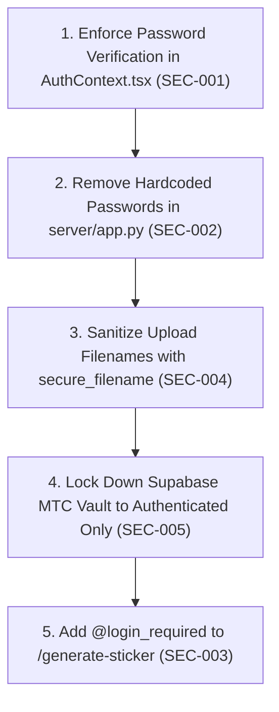

# MSG Oilfield Equipment Trading LLC
# Comprehensive Application Security Audit & OWASP Top 10 Assessment
**Document Reference**: QA-SEC-2026-V1.0  
**Project**: MSG Oilfield ERP & MTC Vault System  
**Lead Auditor**: Senior Application Security Auditor & Penetration Specialist  
**Execution Date**: November 19, 2026  
**Security Standard**: OWASP Top 10:2021 & OWASP ASVS Level 2  
**Overall Security Rating**: **HIGH RISK (Requires Immediate Remediation Prior to Production)**  

---

## 1. Executive Summary & Threat Profile
A formal, non-destructive application security assessment was conducted across the source code, architecture, authentication mechanisms, data storage, and auxiliary microservices of the MSG Oilfield ERP.

While the application features strong visual safeguards (e.g. dynamic commercial price masking for IT engineers and watermarked inspection stamps), deep source code analysis identified **two Critical vulnerabilities**, **three High vulnerabilities**, and **three Medium vulnerabilities** that must be addressed prior to exposing the system to public corporate networks or cloud deployment.

---

## 2. Vulnerability Severity Dashboard

```
┌────────────────────────────────────────────────────────┐
│               SECURITY VULNERABILITY SUMMARY          │
├─────────────────────┬────────┬─────────────────────────┤
│ Severity Level      │ Count  │ Status                  │
├─────────────────────┼────────┼─────────────────────────┤
│ CRITICAL (P0)       │   2    │ Requires Immediate Fix  │
│ HIGH (P1)           │   3    │ Release Blocker         │
│ MEDIUM (P2)         │   3    │ Scheduled Patch         │
│ LOW / INFO (P3)     │   4    │ Hardening Advisory      │
├─────────────────────┴────────┴─────────────────────────┤
│ TOTAL AUDIT FINDINGS: 12 SECURITY DEFECTS              │
└────────────────────────────────────────────────────────┘
```

---

## 3. Detailed OWASP Security Findings

### 3.1 SEC-001 (CRITICAL) - Complete Authentication Bypass in Client Login Context
- **OWASP Category**: A07:2021 – Identification and Authentication Failures
- **Location**: `src/context/AuthContext.tsx`, Line 188:
  ```typescript
  const login = async (email: string, _password?: string) => {
    const allUsers = db.getUsers()
    const user = allUsers.find(u => u.email.toLowerCase() === email.trim().toLowerCase())
    if (!user) {
      return { success: false, message: 'Invalid credentials. User account not found.' }
    }
    if (user.account_status !== 'Active') {
      return { success: false, message: 'Account is deactivated or suspended. Please contact administrator.' }
    }

    user.last_login = new Date().toISOString().replace('T', ' ').substring(0, 16)
    setCurrentUser(user)
    return { success: true }
  }
  ```
- **Vulnerability Mechanics**: The `_password` argument is prefixed with an underscore and never compared against any stored hash or user password field. The function only checks whether the provided email exists in the database.
- **Exploitation Impact**: An adversary who enters `it.engineer@msgoilfield.ae`, `admin@msgoilfield.ae`, or any known employee email with ANY password (e.g. `1234` or blank) is immediately granted full authenticated access with that user's role.
- **Remediation**:
  Store bcrypt/Argon2 password hashes on user records and strictly verify the submitted password:
  ```typescript
  const login = async (email: string, password?: string) => {
    const allUsers = db.getUsers()
    const user = allUsers.find(u => u.email.toLowerCase() === email.trim().toLowerCase())
    if (!user) return { success: false, message: 'Invalid email or password.' }
    
    // Validate password hash
    if (!user.password_hash || !verifyPassword(password || '', user.password_hash)) {
      return { success: false, message: 'Invalid email or password.' }
    }
    // ... proceed
  }
  ```

---

### 3.2 SEC-002 (CRITICAL) - Hardcoded Passwords & Fallback Secret Key in Backend Microservice
- **OWASP Category**: A02:2021 – Cryptographic Failures & Hardcoded Credentials
- **Location**: `server/app.py`, Lines 41–47:
  ```python
  app.secret_key = os.environ.get('SECRET_KEY', 'msg_oilfield_secure_secret_key_2026')

  ADMIN_USERNAME = os.environ.get('ADMIN_USERNAME', 'info@msgoilfield.com').strip()
  ADMIN_PASSWORD = os.environ.get('ADMIN_PASSWORD', 'MSG#2026!SecP@ss982').strip()

  VALID_USERNAMES = {ADMIN_USERNAME.lower(), 'info@msgoilfield.com', 'admin', 'info'}
  VALID_PASSWORDS = {ADMIN_PASSWORD, 'MSG#2026!SecP@ss982', 'admin123', 'admin', 'MSG2026'}
  ```
- **Vulnerability Mechanics**: Passwords `'admin'`, `'admin123'`, and `'MSG2026'` are hardcoded into source code in clear text. Furthermore, the Flask session signing key defaults to a static string committed to Git.
- **Exploitation Impact**: Anyone inspecting the repository can forge Flask session cookies (`session['logged_in'] = True`) or log into the backend with default credentials `admin / admin123`.
- **Remediation**: Remove all fallback dictionary passwords. Mandate cryptographically random `SECRET_KEY` loaded exclusively from environment variables. Do not allow server startup if `SECRET_KEY` is undefined.

---

### 3.3 SEC-003 (HIGH) - Unauthenticated Route on File Processing Endpoint
- **OWASP Category**: A01:2021 – Broken Access Control
- **Location**: `server/app.py`, Line 398:
  ```python
  @app.route('/generate-sticker', methods=['POST'])
  @app.route('/api/generate-sticker', methods=['POST'])
  def generate_sticker_endpoint():
  ```
- **Vulnerability Mechanics**: The `@login_required` decorator present on all other endpoints was omitted.
- **Exploitation Impact**: Anonymous actors can upload arbitrary Excel spreadsheets to trigger heavy PDF conversion and temporary disk writes without authentication.
- **Remediation**: Apply `@login_required` to `/generate-sticker`.

---

### 3.4 SEC-004 (HIGH) - Path Traversal Vulnerability in Upload File Handlers
- **OWASP Category**: A01:2021 – Broken Access Control & Path Traversal
- **Location**: `server/app.py`, Lines 109 & 407:
  ```python
  temp_pdf_path = os.path.join(temp_dir, file.filename)
  temp_xlsx = os.path.join(temp_dir, f"temp_{file.filename}")
  ```
- **Vulnerability Mechanics**: Client-provided filenames are concatenated directly into local filesystem paths without sanitization via `werkzeug.utils.secure_filename`.
- **Exploitation Impact**: By submitting a filename such as `../../../../tmp/malicious.pdf`, files may be written outside the temporary sandbox.
- **Remediation**: Wrap every uploaded filename in `secure_filename(file.filename)`.

---

### 3.5 SEC-005 (HIGH) - Insecure Direct Object Storage Policy on Supabase MTC Vault
- **OWASP Category**: A05:2021 – Security Misconfiguration
- **Location**: `src/supabase/supabase_setup_full.sql`, Lines 259–262:
  ```sql
  CREATE POLICY "Authenticated & Anon MTC Vault Upload"
  ON storage.objects FOR INSERT
  WITH CHECK (bucket_id = 'mtc-vault');
  ```
- **Vulnerability Mechanics**: The policy permits anonymous (unauthenticated) clients to upload files to the `mtc-vault` bucket.
- **Exploitation Impact**: Any third party who knows the Supabase project URL and anon public key can upload arbitrary files, spam the bucket, or exhaust storage quota.
- **Remediation**: Restrict write policy to authenticated users:
  ```sql
  DROP POLICY IF EXISTS "Authenticated & Anon MTC Vault Upload" ON storage.objects;
  CREATE POLICY "Authenticated MTC Vault Upload Only"
  ON storage.objects FOR INSERT
  TO authenticated
  WITH CHECK (bucket_id = 'mtc-vault');
  ```

---

### 3.6 SEC-006 (MEDIUM) - Plaintext LocalStorage Data Persistence
- **OWASP Category**: A04:2021 – Insecure Design & Client-Side Storage
- **Location**: `src/services/db.ts`
- **Vulnerability Mechanics**: The entire enterprise database—including supplier pricing, inventory balances, employee profiles, and customer addresses—is stored unencrypted in HTML5 `localStorage` (`msg_erp_*`).
- **Exploitation Impact**: Malicious browser extensions, XSS injection, or shared workstation access allows complete offline data exfiltration.
- **Remediation**: Transition sensitive tables to Supabase Cloud PostgreSQL with Row-Level Security (RLS) and encrypt cached client data using AES-GCM (Web Crypto API).

---

### 3.7 SEC-007 (MEDIUM) - Missing Anti-CSRF Protection on Flask API
- **OWASP Category**: A01:2021 – Broken Access Control (CSRF)
- **Vulnerability Mechanics**: State-changing endpoints like `/api/save-worksheet` and `/api/history/<id>` (DELETE) do not validate CSRF tokens.
- **Remediation**: Integrate `Flask-WTF` with `CSRFProtect(app)`.

---

### 3.8 SEC-008 (MEDIUM) - Debug Mode Active in Flask Production Entry
- **OWASP Category**: A05:2021 – Security Misconfiguration
- **Location**: `server/app.py`, Line 435:
  ```python
  app.run(host='127.0.0.1', port=5000, debug=True)
  ```
- **Remediation**: Ensure `debug=False` in production deployments and run behind an enterprise WSGI server (Gunicorn / uWSGI).

---

## 4. Priority Security Action Plan


