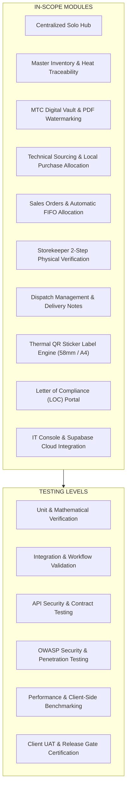

# MSG Oilfield Equipment Trading LLC
# Software Testing Strategy & QA Governance Framework
**Document Reference**: QA-STRAT-2026-V1.0  
**Project**: MSG Oilfield ERP & MTC Vault System  
**Lead Auditor**: Senior QA Architect & Principal Security Specialist  
**Execution Date**: November 19, 2026  
**Target Environment**: Staging & Production Readiness Assessment  

---

## 1. Executive Summary & Purpose
This Software Testing Strategy defines the end-to-end quality assurance governance, verification protocols, risk-based test design, and automated testing architecture for the **MSG Oilfield ERP & MTC Vault System**. 

The application is an enterprise material traceability, automated heat certification, inventory reservation, and commercial sourcing platform deployed for oil & gas piping, valves, and flange distribution in the UAE and international markets. Due to the high-compliance nature of Mill Test Certificates (EN 10204 3.1 / 3.2), material heat verification, and custom clearance documentation (CIPL), this QA strategy mandates rigorous multi-layer testing spanning static code analysis, functional verification, business rule enforcement, API penetration testing, performance benchmarking, and user acceptance testing (UAT).

---

## 2. Testing Scope & Boundaries



### 2.1 In-Scope Components
1. **Frontend Architecture**: React 19.3.1, TypeScript 7.0.2, Tailwind CSS 4.3.3 Single Page Application (SPA).
2. **Client-Side Analytical Engines**:
   - `sourcingEngine.ts`: Dual Excel Generation (Client / Stores), CIPL Workbook, Supplier PO ZIP, HSN Code Engine.
   - `pdfEngine.ts`: Client-side parsing and PDF stamping using `pdf-lib`.
   - `excelEngine.ts`: High-speed XLSX streaming and Zoho Books catalog ingestion.
   - `stickerEngine.ts`: Vector QR code generation and thermal label layout generation.
   - `locEngine.ts`: Letter of Compliance certificate generation with official QA/QC seals.
3. **Reactive In-Memory & LocalStorage Database (`db.ts`)**:
   - 11 core data stores: `customers`, `items`, `lots`, `balances`, `orders`, `mtcs`, `local_purchases`, `movements`, `returns`, `users`, `system_config`.
   - Self-healing allocation sanitizer and FIFO automatic allocation algorithms.
4. **Cloud Backend & Storage**:
   - Supabase PostgreSQL schema (`supabase_setup_full.sql`) and `mtc-vault` S3-compatible cloud bucket.
   - Auxiliary Python Flask API service (`server/app.py`).

### 2.2 Out-of-Scope Components
- Live payment gateways (system operates on corporate purchase orders, LC transmittals, and credit invoicing).
- External physical thermal printer firmware (testing simulates raster and PDF stream outputs).

---

## 3. Test Methodology & Test Pyramid

```
                ▲
               / \
              /UAT\             Level 4: Client Acceptance & Role Workflows (Manual/Visual)
             /-----\
            / End-to\           Level 3: End-to-End Workflow Verification (Solo Hub, Sourcing)
           /  End    \
          /-----------\
         / Integration \        Level 2: API Contract & Data Synchronization (Supabase, State)
        /---------------\
       /    Unit / Pure  \      Level 1: Heuristic Engines (HSN, FIFO, Weight, OCR)
      /___________________\
```

### 3.1 Level 1: Pure Unit & Heuristic Logic Testing
- **FIFO Allocation Algorithm**: Ensures oldest received lots (earliest receipt date) are depleted first before newer heats are allocated.
- **HSN Classification Engine**: Verifies that 100% of standard oilfield materials (flanges, butt-weld fittings, seamless pipes, stud bolts, gaskets, valves) map strictly to 8-digit GCC tariff codes.
- **Weight Estimation Matrix**: Validates unit weight estimation formulas ($kg$) and gross weight safety buffer ($15\%$) across carbon steel, stainless steel, and nickel alloys.

### 3.2 Level 2: Component Integration & State Synchronization
- **Reactive Data Bus (`db.subscribe`)**: Verifies that state changes made in one module (e.g. allocating heat in Solo Hub) instantly update Master Stock, Traceability Modals, and Dashboard KPI counts without requiring manual page refresh.
- **Cloud Failover & Synchronization**: Verifies that if Supabase is offline or unconfigured, the application falls back gracefully to local browser storage without crashing or data loss.

### 3.3 Level 3: Security & Penetration Testing (OWASP Top 10)
- Detailed inspection of authentication bypasses, local storage vulnerability, file upload directory traversal, unauthenticated API endpoints, and role privilege escalation.

### 3.4 Level 4: Client Acceptance & Role Workflow Testing
- Structured testing across all 8 user personas: Primary Root IT Administrator, Super Admin, Inventory Manager, Sales Team, Storekeeper, MTC QA/QC Controller, Dispatch Team, and Solo Operator.

---

## 4. Test Environments & Infrastructure

| Environment | Host URL / Port | Purpose | Database Backend |
|:---|:---|:---|:---|
| **Local Development** | `http://localhost:5173` | Unit, Linting, & Code Review | Local Storage + Mock Supabase |
| **Local Aux Backend** | `http://127.0.0.1:5000` | Python Flask Services Testing | SQLite / Local Temp Storage |
| **Cloud Staging** | `https://msg-oilfield.supabase.co` | Cloud Database & MTC Vault Verification | Supabase PostgreSQL 15 |
| **Production Target** | GitHub `MSGERPLIVE` (main) | Final Release Verification | Supabase Cloud + Static CDN |

---

## 5. Entry & Exit Criteria

### 5.1 Entry Criteria
1. Complete codebase builds successfully (`npm run build` exits with code 0).
2. Clean static analysis scan run via `oxlint`.
3. Test accounts provisioned for all 8 system roles.
4. Supabase cloud schema script executed in database project.

### 5.2 Release Exit Criteria (Quality Gates)
- **Zero Critical (Severity 1) Bugs**: No data corruption, authentication bypass, or arbitrary code execution.
- **Zero High (Severity 2) Functional Defects**: All core business flows (Order Upload $\to$ Allocation $\to$ Storekeeper Approval $\to$ Dispatch) operate cleanly.
- **Pass Percentage**: Minimum **$95\%$** pass rate on executed functional and regression test cases.
- **MTC Integrity**: $100\%$ accuracy in heat certificate matching, PDF watermarking, and tamper-evident QR code embedding.
- **Document Completeness**: All 13 mandatory QA audit documents reviewed and signed off.

---

## 6. Defect Severity & Priority Classification Matrix

| Severity Level | Impact Definition | SLA / Resolution Action |
|:---|:---|:---|
| **CRITICAL** | Total system failure, authentication bypass, data loss, security exposure of customer pricing, or unhandled crash. | Immediate blocker. Must be patched before release. |
| **HIGH** | Major workflow disruption (e.g. HSN code failure, FIFO calculation error, PDF export corruption). No clean workaround. | Must be resolved before production deployment. |
| **MEDIUM** | Non-critical functionality defect, performance degradation, or missing validation with manual workaround. | Scheduled for resolution in sprint or release candidate. |
| **LOW** | Minor cosmetic defect, alignment anomaly, typo, or minor console warning. | Backlog fix. Does not block release. |

---

## 7. Quality Assurance Tools & Frameworks

| Testing Dimension | Tool / Technology | Configuration & Role |
|:---|:---|:---|
| **Static Code Analysis** | `oxlint` v1.89.0 | Fast static linting for AST rules, unused variables, and React hooks. |
| **Compilation & Type Check** | `tsc -b` (TypeScript 7.0.2) | Strict type-safety, interface validation, and build verification. |
| **E2E / Functional Scripts** | Node.js ESM (`test_suite.mjs`) | Automated algorithmic acceptance tests for FIFO, Stock balances, and Role mappings. |
| **API Contract Testing** | Python `unittest` (`server/test_app.py`) | Endpoint status, MIME type validation, and payload integrity. |
| **Security Scanning** | Static Code Audit & OWASP Top 10 | Source code tracing, regex analysis, and auth parameter auditing. |
| **Bundle & Performance** | Vite Build Reporter & Rollup Analyzer | Asset chunk inspection, bundle footprint analysis, and minify verification. |
